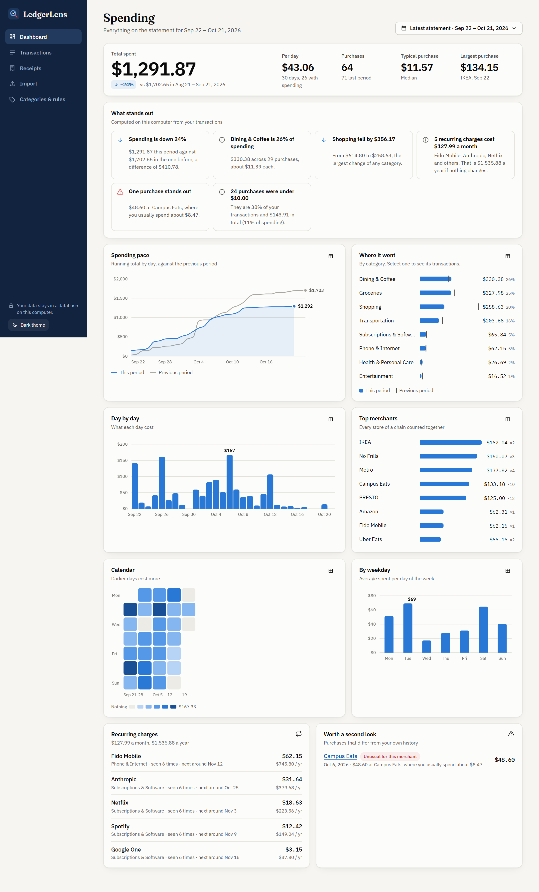
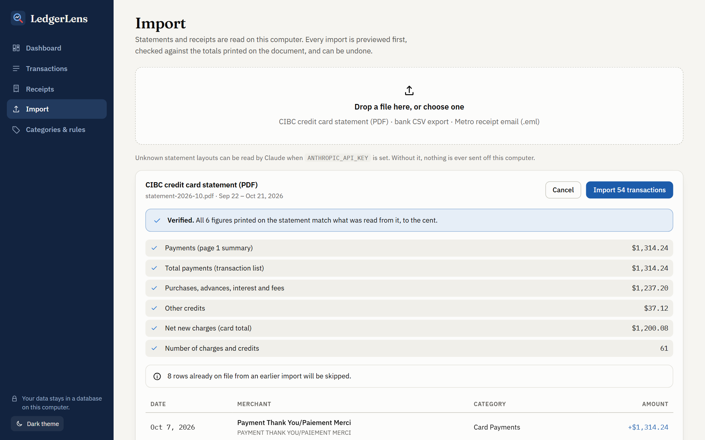
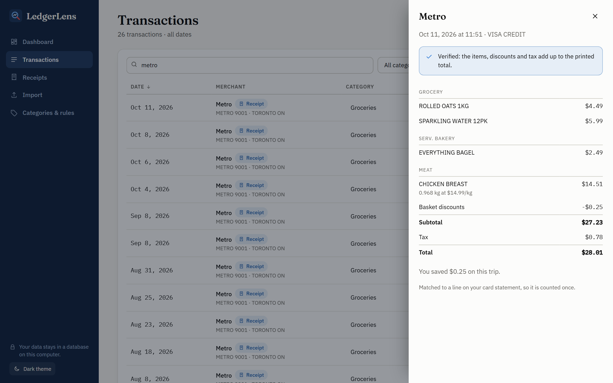
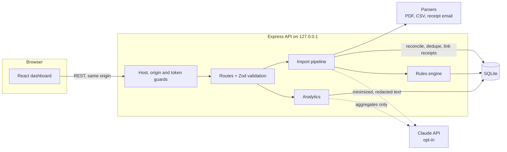

# LedgerLens

[](https://github.com/Harshil-212369/Personal-Expense-Tracker/actions/workflows/ci.yml)

A personal expense tracker that reads your card statements and grocery receipts, proves it read them correctly, and shows where the money went. It runs entirely on your own computer.



Every screenshot here shows invented data from a seeded generator. No real statement, receipt or person appears anywhere in this repository, and the build enforces that (see [Privacy](#privacy-by-construction)).

## What it does

- **Reads statements and proves the result.** Drop in a CIBC credit card statement (PDF), a bank CSV export, or a Metro receipt email (`.eml`). The parser recomputes every total the document prints (purchases, credits, payments, transaction count) and marks the import *Verified* only if each one matches to the cent.
- **Counts each dollar once.** A file imported twice is a no-op. The same transactions arriving as PDF and as CSV are recognized as duplicates. Two identical transit fares on one day are both kept.
- **Itemizes groceries.** A receipt email is parsed into line items with weights and unit prices, then linked to the statement line it explains.
- **Analytics.** Spending pace against the previous statement, category and merchant breakdowns, a calendar heatmap, recurring-charge detection, and outlier detection that compares a purchase with your own history.
- **Categorization that learns.** Correct one transaction and it offers to become a rule for every past and future transaction from that merchant.
- **Optional AI, off by default.** With an Anthropic API key, Claude can read statement layouts the built-in parsers don't know, categorize unfamiliar merchants, and narrate insights. Without a key, nothing leaves the machine.

| Import preview with reconciliation | Receipt behind a statement line |
|---|---|
|  |  |

## Quick start

Requires Node.js 22.18 or newer. No database to install and no compiler: the server uses Node's built-in SQLite module and runs TypeScript directly.

```bash
git clone https://github.com/Harshil-212369/Personal-Expense-Tracker.git
cd Personal-Expense-Tracker
npm install
npm run demo
```

Open http://localhost:4000. `npm run demo` builds the UI, generates six months of synthetic statements and receipts, and imports them through the real pipeline.

With your own data:

```bash
npm run build
npm start
```

Then use the **Import** page, or drop files into `data/inbox/` and run `npm run ingest`. Your database lives in `data/`, which is git-ignored.

For development, `npm run dev` runs the API on port 4000 and the Vite dev server on port 5173 with hot reload.

## Stack

| Layer | Choice |
|---|---|
| Front end | React 19, TypeScript, Vite, React Router, TanStack Query, hand-built SVG charts on d3-scale |
| API | Node.js, Express 5, Zod validation, RFC 9457 problem-details errors |
| Storage | SQLite (`node:sqlite`), SQL migrations, integer cents, `STRICT` tables with `CHECK` constraints |
| Parsing | pdf.js text layer with coordinates, postal-mime, csv-parse |
| AI (optional) | Anthropic SDK with schema-constrained output |
| Tests | Node test runner + Supertest, Vitest + Testing Library, Postman CLI, Playwright + axe-core |
| Delivery | GitHub Actions, Docker, Dependabot, gitleaks |

## Architecture



The API contract lives in one file, [`server/src/contracts.ts`](server/src/contracts.ts). The server validates requests against it and the web app imports its types, so the two cannot drift apart without a compile error. More in [docs/ARCHITECTURE.md](docs/ARCHITECTURE.md).

## Privacy by construction

A finance app's repository should make it hard to leak finances. Four layers, each independent of the others:

1. **`.gitignore` by type.** Statements, exports, databases, photos and key files are ignored by extension wherever they sit, with one allowlisted folder for synthetic fixtures.
2. **Pre-commit and pre-push guard.** [`scripts/privacy-guard.mjs`](scripts/privacy-guard.mjs) has no dependencies and scans exactly what is staged. It refuses data files, API keys and tokens, private keys, Luhn-valid card numbers, Canadian SINs, and any string in your personal, git-ignored `.privacy-denylist` (address, account digits, loyalty number). It installs itself on `npm install`.
3. **CI.** The same guard runs on every tracked file, and gitleaks scans the full history.
4. **Synthetic fixtures only.** Tests, the demo and the screenshots come from a seeded generator, so there is never a reason to commit a real document.

At runtime the server binds to loopback, refuses to start on any other interface without an API token, rejects requests whose `Host` is not local (DNS rebinding) and cross-origin writes (CSRF), never logs request bodies or query strings, and parses uploads in memory without writing them to disk.

Full threat model and what the optional AI features send: [docs/SECURITY.md](docs/SECURITY.md).

## API

All routes are under `/api`. Errors are `application/problem+json`. Money is integer cents.

| Method | Path | Purpose |
|---|---|---|
| GET | `/health` | Status, version, whether AI and token auth are on |
| GET, POST | `/transactions` | List with filters, search, sort, pagination; create |
| GET, PATCH, DELETE | `/transactions/:id` | Read, update, delete |
| GET, POST | `/categories` | List, create |
| PATCH, DELETE | `/categories/:id` | Rename or delete a custom category |
| GET, POST | `/rules` | List, create (re-categorizes existing transactions) |
| DELETE | `/rules/:id` | Delete |
| POST | `/rules/apply` | Re-run the rules |
| GET, POST | `/imports` | History; upload a file (`?dryRun=true` previews, `?parser=ai` uses Claude) |
| GET, DELETE | `/imports/:id` | Read; roll back everything the import added |
| GET | `/receipts`, `/receipts/:id` | Receipts and their line items |
| GET | `/analytics/summary`, `/categories`, `/timeseries`, `/merchants`, `/calendar`, `/recurring`, `/anomalies`, `/habits`, `/groceries`, `/insights` | Analytics, by `from`/`to` or by `importId` (one statement) |
| POST | `/ai/insights`, `/ai/categorize` | Opt-in; 503 without a key |

The Postman collection in [`postman/`](postman) documents and tests every route.

## Testing

```bash
npm run verify      # privacy guard, lint, typecheck, unit tests
npm run test:api    # Postman collection against a throwaway server and database
npm run test:e2e    # Playwright journey against the production build (run npm run build first)
```

| Suite | What it covers |
|---|---|
| Server (142 tests, 90% line-coverage gate) | Parsers against synthetic statements, import idempotency and rollback, receipt linking, every route, security guards, analytics arithmetic, the AI path against a local fake of the API |
| Web (28 tests) | Formatting, period logic, components, and page flows against a mocked API |
| Privacy guard (20 tests) | File rules, secret patterns, card and SIN detection, the denylist |
| API contract (45 requests) | Status codes, response shapes, and cross-endpoint invariants such as "categories sum to the headline total" |
| End to end (16 steps) | First run, import, dashboard, corrections, receipts, undo; axe accessibility checks in both themes; phone layout |

## Project layout

```
server/   Express API, parsers, analytics, migrations, tests, synthetic data generator
web/      React app
e2e/      Playwright journey and screenshot capture
postman/  API collection
scripts/  privacy guard, git hook installer, API test runner
docs/     architecture and security notes, screenshots
```

## Supported documents

| Document | Parser | Verified against |
|---|---|---|
| CIBC credit card eStatement (PDF) | Built in | Six printed figures, including the transaction count |
| CIBC transaction export (CSV) | Built in | Nothing: CSV exports print no totals |
| Any CSV with date, description and amount columns | Built in | Nothing |
| Metro digital receipt (`.eml`) | Built in | Items + discounts = subtotal; subtotal + tax = total; item count |
| Other statement layouts | Claude, opt-in | Whatever totals the document prints |

## Roadmap

- Gmail API ingestion so receipt emails arrive without saving a file
- More statement layouts (chequing accounts, other banks)
- Budgets per category with pace alerts
- An MCP server exposing the analytics to AI assistants
- CodeQL analysis once the repository is public

## License

MIT. See [LICENSE](LICENSE).
